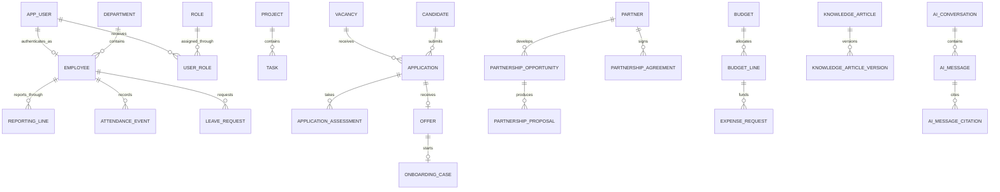

# MyCity Database Schema

This document describes the PostgreSQL 16 schema created by `migrations/`. The physical model uses
UUID primary keys, foreign keys for durable relationships, `numeric(18,2)` for money, JSONB only for
variable metadata, and `created_at` / `updated_at` timestamps on mutable records.

Payroll is deliberately not modelled. The M6 payroll block (`6000`–`6999`) is reserved until the
tax-reform rules and payroll contract are approved. Sanction fines remain standalone and do not
post to payroll.

## Relationship map

## Table catalogue

### Platform foundation (M0)

| Tables | Representation and responsibility |
|---|---|
| `schema_migration`, `system_marker` | Applied-migration ledger and environment/system identity. |
| `app_user`, `user_session`, `known_device`, `password_reset` | Login identity, active sessions, trusted devices and password recovery. |
| `role`, `user_role`, `permission`, `field_visibility` | Role-based access and field masking. |
| `capability`, `user_capability` | Temporary or explicitly scoped access beyond a role. |
| `event_log`, `audit_ledger`, `event_outbox`, `error_event` | Business events, immutable audit facts, reliable event delivery and operational errors. |
| `idempotency_key` | Prevents duplicate mutation processing. |
| `department`, `worksite`, `employee`, `reporting_line` | Organisation structure, workplaces, staff records and effective-dated reporting lines. |
| `setting`, `working_week`, `public_holiday`, `reference_value` | Governed configuration, calendar rules and controlled lookup values. |
| `numbering_scheme`, `numbering_counter` | Configurable, transactional document-number allocation. |
| `notification`, `notification_preference`, `push_subscription`, `alert` | In-app delivery, user channel choices, web-push endpoints and actionable alerts. |
| `workflow_definition`, `workflow_instance`, `workflow_decision`, `entity_state_history` | Versioned approvals, running workflows, decisions and state audit history. |
| `document`, `document_variant`, `template`, `template_version` | Governed file metadata, derived media and versioned document templates. |
| `import_batch`, `import_row`, `import_mapping_profile` | Import lifecycle, row validation/results and reusable mappings. |
| `integration_secret`, `public_token` | Encrypted integration credentials and hashed limited-purpose public tokens. |
| `ai_setting`, `ai_run`, `ai_run_step`, `ai_catalogue` | AI governance, cost/audit runs, execution steps and allowed operations. |

### Core operations (M1)

| Tables | Representation and responsibility |
|---|---|
| `home_alert_rule`, `home_alert` | Rules that derive Home alerts and their user-facing instances. |
| `attendance_policy`, `employee_attendance_policy` | Attendance rules and effective employee assignments. |
| `attendance_event`, `attendance_day`, `attendance_exception` | Raw clock events, daily calculations and reviewable exceptions. |
| `leave_type`, `leave_balance`, `leave_request` | Leave policy types, employee balances and approval requests. |
| `community_channel`, `community_member`, `community_message`, `community_reaction` | Internal community conversations and reactions. |
| `peer_recognition`, `announcement` | Staff recognition and governed organisation announcements. |
| `mail_account`, `mail_folder`, `mail_thread`, `mail_message`, `mail_attachment` | Connected mail metadata and its document-backed attachments. |
| `saved_report`, `report_schedule` | Saved reporting definitions and scheduled delivery. |

### Productivity and performance (M2)

| Tables | Representation and responsibility |
|---|---|
| `project`, `task`, `task_assignee`, `task_comment` | Work plans, actionable tasks, assignees and collaboration. |
| `calendar_event` | Personal and shared scheduled events. |
| `organisational_goal` | Five-level hierarchical organisational goals. |
| `kpi_definition`, `employee_target` | Reusable KPI definitions and employee-period targets. |
| `performance_cycle`, `performance_review`, `performance_review_item` | Review periods, employee reviews and scored KPI/competency lines. |

### Queries and sanctions (M3)

| Tables | Representation and responsibility |
|---|---|
| `query_rule`, `employee_query`, `query_response` | Disciplinary query rules, issued cases and employee responses. |
| `sanction`, `sanction_fine`, `sanction_letter` | Approved consequences, standalone fines and generated letters. |

### Recruitment (M4)

| Tables | Representation and responsibility |
|---|---|
| `vacancy`, `vacancy_question` | Open roles and their application questions. |
| `candidate`, `application`, `application_stage_history` | Candidate identity, per-vacancy applications and pipeline history. |
| `recruitment_scorecard_criterion` | Weighted vacancy evaluation criteria. |
| `assessment_definition`, `assessment_question`, `application_assessment`, `assessment_response` | Versioned assessments, assignments and candidate answers/scores. |
| `interview_round`, `interview`, `interview_panelist`, `interview_feedback` | Interview scheduling and independent panel feedback. |

### Offers and onboarding (M5)

| Tables | Representation and responsibility |
|---|---|
| `offer` | Approved employment offer and terms for an application. |
| `signature_request`, `signature` | Document-signing workflow and signer evidence. |
| `document_requirement` | Reusable onboarding evidence requirements. |
| `onboarding_case`, `onboarding_checklist_item` | Candidate-to-employee onboarding and owned completion tasks. |
| `employment_contract` | Signed, date-bounded employment contract metadata. |
| `talent_pool`, `talent_pool_member` | Reusable candidate pools and membership. |

### Partnerships (M7)

| Tables | Representation and responsibility |
|---|---|
| `partner`, `partner_contact` | Partner organisations and their contacts. |
| `partnership_opportunity`, `partnership_stage_history` | Partnership pipeline and stage audit trail. |
| `partner_interaction` | Calls, mail, meetings and notes against partners/opportunities. |
| `partnership_proposal` | Versioned commercial or programme proposals. |
| `partnership_agreement`, `agreement_obligation` | Executed agreements and tracked commitments. |

### Expenses (M8)

| Tables | Representation and responsibility |
|---|---|
| `expense_category` | Hierarchical controlled expense classification. |
| `budget`, `budget_line` | Date-bounded budgets and category allocations. |
| `expense_request` | Employee funding request and approval state. |
| `requisition`, `requisition_line` | Purchase request header and itemised lines. |
| `disbursement`, `expense_transaction` | Payment execution and financial movement history. |

### Governance (M9)

| Tables | Representation and responsibility |
|---|---|
| `security_event` | Investigable authentication, access and security events. |
| `access_review`, `access_review_item` | Periodic certification of user roles and capabilities. |
| `integration_connection` | Provider configuration linked to separately stored secrets. |
| `webhook_endpoint`, `webhook_delivery` | Outbound subscriptions and retryable delivery history. |

### Knowledge and AI assistance (M10)

| Tables | Representation and responsibility |
|---|---|
| `knowledge_category`, `knowledge_article`, `knowledge_article_version` | Categorised, reviewable and immutable-version knowledge content. |
| `knowledge_embedding` | Searchable article chunks and vector embeddings. |
| `ai_conversation`, `ai_message`, `ai_message_citation` | Assistant conversations, messages and verifiable source citations. |

## Seed policy

Files containing `_seed_` live in `seeds/reference/`. They use the same milestone number blocks as
the schema files in `migrations/`, and `db:migrate` interleaves both folders by number. They contain
only deterministic product/reference data and use conflict handling so they can be run repeatedly.
They do not create staff, candidates, transactions or other environment-specific/demo records.
