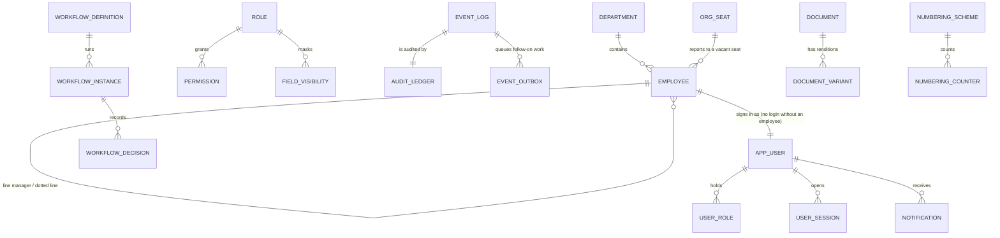

# MyCity App ERP · Database Design

The one map of the database: what exists, which milestone owns it, how a milestone's tables attach
to the core, and what is still to be built, with what is deliberately not built and why. An
engineer starting a milestone reads this first, then `docs/MIGRATIONS.md` for how to write the
files.

| Document | Settles |
|---|---|
| `docs/MyCity-ERP-Documents/MILESTONES.md` | Scope and decisions A1 to A26. Binding |
| `docs/guides/<module>.md` §4 | The tables a feature needs, field by field |
| **This file** | What is built, where, who owns it, and what each milestone still owes |
| `docs/MIGRATIONS.md` | How a migration or reference seed is written and checked |
| `migrations/`, `seeds/reference/` | The schema itself. Where this file and the SQL disagree, the SQL is the fact and this file is fixed |

Status as of 19/10/2026 (`main` with attendance's clock, `1300` and `1390`, remote staff's approved homes, `1310` and `1391`, work location requests, `1320` and `1392`, field assignments, `1330` and `1393`, hybrid staff's weekly schedule, `1340`, a client visit's site, `1350`, the clock watch, `1360` and `1394`, Home's foundation, `1150` and `1199`, Home's alerts, `1151`, the mailbox's image trust, `1125`, email signatures, `1127` and `1129`, web push, `0460`, notice urgency, `0470` and `1145`, Settings · Notifications and the reminder engine, `0480`, and the effective manager through a vacant seat, `1160`): 84 files, 171 tables and 6 views. Gate 6
(`check/schema-drift.js`, `check/contract-columns.js`) checks the code and the contract against
the same reading of the migrations on every PR.

---

## 1 · Shape of the database

- **Two databases, not two schemas:** `mycity_stg` and `mycity_prod`, each with its own role and
  no cross-grants (SYSTEM_ARCHITECTURE §5). Every table is in `public`.
- **One migration ledger,** `schema_migration` (name, sha256, applied_at), written only by
  `scripts/db/migrate.js`. Files apply by number, `migrations/` and `seeds/reference/` interleaved.
- **One environment marker,** `system_marker(environment)`, one row, written when the database is
  created (provisioning on servers), never by a migration. Seed tooling refuses a database whose
  marker is missing or says `production`.
- **Extensions:** `pgcrypto`, `citext`, `pg_trgm`, `unaccent` (trusted, created by `0001`) and
  `vector` (untrusted, created by `ops/provision/provision.sh` as the superuser first).
- **Shared functions** (`0001`): `set_updated_at()` for every mutable table's trigger,
  `prevent_ledger_mutation()` for append-only tables, `search_fold()` for accent-folded search.

## 2 · The core every milestone builds on (M0)

Every module's tables hang off a small core. A new table attaches to it in the ways below and never
builds its own copy of any of them (CLAUDE.md: no second copy of a shared concern).

| Concern | Tables | Written by (the only writer) | How a module attaches |
|---|---|---|---|
| People and structure | `employee`, `department`, `worksite`, `org_seat`, `reporting_line` | organisation service, staff importer | `employee_id uuid REFERENCES employee`. Team scope follows the solid line: `employee.line_manager_id`, or, for someone who reports to a vacant seat, the first person above it (`employee_effective_manager`, `1160`). The dotted line never grants scope |
| Sign-in | `app_user`, `user_session`, `password_reset`, `known_device`, `mfa_recovery_code`, `passkey`, `spent_challenge` | identity service; the security service for two-step, the PIN and passkeys (the `mfa_*` and `pin_*` columns of `app_user`, `mfa_recovery_code`, `passkey`, `spent_challenge`) | `user_id` for who acted; never an email or a name. A key, a code, a PIN or a credential is never copied out |
| Access | `role`, `permission`, `field_visibility`, `capability`, `user_role`, `user_capability` | access service | A module's permission key in `access.catalog.js`; restricted columns named in `field-mask.js` |
| History | `event_log`, `audit_ledger` (append-only), `event_outbox`, `entity_state_history` | `emit()` in the same transaction as the write | Every write calls `emit()`; follow-on work is an outbox handler, never a second write path |
| Approvals | `workflow_definition`, `workflow_instance`, `workflow_decision` | `shared/workflow` | `workflow_instance_id` on the record waiting for approval; definitions seeded only if they pass `validateDefinition()` |
| Files | `document`, `document_variant`, `template`, `template_version`, `document_request` | `shared/documents/vault`; the documents service for `document.verified_at` and `document_request` | `document_id uuid REFERENCES document`; never a path or a URL. A document People asked for and have not been given is a `document_request`, not a `document` (`docs/guides/foundation.md` §6.9) |
| Numbers | `numbering_scheme`, `numbering_counter` | `numbering.allocate()` | `number citext NOT NULL UNIQUE` (or the contract's name for it, `staff_number`) and a scheme in `schemes.js` |
| Notifications | `notification`, `notification_preference`, `push_subscription`, `push_delivery`, `notification_rule`, `notification_rule_recipient`, `notification_reminder_rule`, `notification_setting`, `reminder`, `alert` | `shared/notifications` fan-out (`notification`); the notifications service (preferences and devices) and its push sender (`push_delivery`) | An outbox handler that calls the fan-out; never an insert into `notification` |
| Settings | `setting`, `working_week`, `public_holiday`, `reference_value` | settings service | Read settings; a code list the code switches on is a `reference_value` domain |
| Imports | `import_batch`, `import_row`, `import_mapping_profile` | `shared/import` engine | An importer in the module (`<module>.import.js`) |
| Errors, tokens, secrets, AI | `error_event`, `idempotency_key`, `public_token`, `integration_secret`, `ai_setting`, `ai_run`, `ai_run_step`, `ai_catalogue`, `ai_model`, `ai_chain`, `ai_provider_cap`, `ai_price_proposal`, `ai_price_run` | shared observability, http, security and AI layers | Not attached to directly; the AI reads through manifests only (A23) |

Every core table above was checked against the shared code that writes it by running
`tests/integration` on the real migrations (#26, #27): the code and the schema agree, and CI keeps
them agreeing.

## 3 · By milestone

Blocks are README §6.3. **Built** lists the tables in `main`. **Owes** is what the milestone's scope
and guides need that is not built yet, from the coverage audit of 16/10/2026; each owner closes it
with new files in their own block, following `docs/MIGRATIONS.md`. A merged file is never edited.

### M0 Foundation · 0001 to 0999 · GE (architecture), LA (migrations and data)

**Built:** `0001` extensions and functions · `0002` `schema_migration`, `system_marker` · `0010`
identity · `0020` access · `0030` events, audit, outbox, errors, idempotency · `0040` organisation ·
`0050` settings · `0055` numbering · `0060` notifications · `0070` workflow · `0080` documents and
templates · `0085` imports · `0090` tokens and secrets · `0095` AI ledger · `0099` reference seed ·
`0100` shared-layer columns · `0110` employee profile, dotted line, `org_seat` · `0120` foreign key
indexes · `0130` `error_event.extra` · `0199` code lists, Saturday, staff numbers · `0200` sessions
(last seen, how opened, device, end reason), credential links for invitations, a role's Home view
and rank · `0210` `employee.home_address` and `contract_ends_on` · `0300` the register: archiving
(`archived_at`, `archive_reason`, `archived` in the status check), `start_date` no longer NOT NULL (a
joining date MyCity does not hold is absent rather than wrong), and the indexes every allow-listed
sort, filter and search of the register reads, with a trigram index on name and post ·
`0349` the `archived` code list · `0220` sign-in methods: two-step
(`mfa_frequency`, the pending key, the last step used, a browser's trust, `mfa_recovery_code`), the
PIN and its wrong-try counts, `passkey`, `spent_challenge`, `user_session.reauthenticated_at` and
`pin_totp` sessions (`docs/guides/identity.md` §4) · `0290` the seven roles and their permission
matrix (`docs/guides/identity.md` §8) · `0350` `document_request` (what People asked an employee for)
and `document.verified_at` and `verified_by` (People accepting a file, which the virus check does
not say; `docs/guides/foundation.md` §6.9) · `0400` `role_capability` (a capability given with a
role), `role.two_step_required`, the Audit Log's indexes on `audit_ledger` and live sessions, and the
`two_step_setup` purpose on `spent_challenge` (`docs/guides/foundation.md` §4, §6.4) · `0449` the
field visibility of every role and the two capabilities given to Implementation, Operations & People
and Management (`docs/guides/foundation.md` §6.3) · `0450` `reassign` as a `workflow_decision` (a stage
given to someone else; `docs/guides/foundation.md` §11) · `0460` web push (brought forward from M6 by
TB, 19/10/2026; `docs/guides/notifications.md` §4): `push_subscription` as a device (its
`known_device`, label and platform, the hash of its device token, the key id it was made under, its
health and why it stopped) and `push_delivery`, one row per notice and device, so a retried push is
never sent twice · `0470` notice urgency (TB, 19/10/2026; `docs/guides/notifications.md` §4, §6):
`notification.urgency`, `acknowledge_required` and `acknowledged_at`, the urgent repeats' pace
(`repeat_count`, `last_alert_at`, `repeat_day`, `repeats_on_day`) and `push_delivery.round`
· `0480` Settings · Notifications and the reminder engine (brought forward from M6 by TB,
19/10/2026; `docs/guides/notifications.md` §4, §7.1): `notification_rule` and
`notification_rule_recipient` (the company's rule per notice and its copies),
`notification_reminder_rule` (approvals, probation, digest), `notification_setting` (a person's
quiet hours and digest) and `reminder` (one row per occurrence of a declared reminder)
· `0490` `place` (TB, 20/10/2026; `docs/guides/addresses.md` §4): every address a person enters, one
row per address field of a record (`owner`, `owner_key`), picked, pinned, the device's location or
typed before the rule, with its line, details, point, kind and whether it waits to be named;
backfilled from every address already saved, as typed and unverified · `0499` the leave flow, `leave.approval` (the line manager, then Operations &
People over 5 days; §6.5) · `0510` `user_guide_passage` (JP, 26/10/2026; `docs/guides/user-guide.md`
§4, §6.8): the User Guide's meaning index, one `vector(1536)` per distinct passage of `docs/manual`
on the Guide Search model, keyed by the hash of what was embedded and the model (HNSW cosine index);
no words, nothing a person typed, rebuilt from the files.

**Owes:**
- The `system_marker` row: provisioning does not write it yet (`ops/provision/provision.sh`).
- `employee_team_closure` (`0040`) is read by no code since 19/10/2026: team scope walks
  `employee_effective_manager` (`1160`) and the reporting-loop check walks people and seats in
  `organisation.repo.wouldLoop`. Drop it in a later file once GE agrees (MIGRATIONS §8).
- ~~The staff importer must advance the `employee` counter past imported staff numbers.~~ Built
  17/10/2026: `numbering.advanceTo()`, called by the organisation service whenever a staff number
  arrives with its record, and by the roster loader at the end of a load.
- **Read by Home** (home.md §4.1, §6 Alerts): Home reads these through their modules' own
  functions, except its alert metrics (`src/modules/alerts/alerts.metrics.js`), which read
  `workflow_instance` (`state = 'pending'`, `stage_entered_at`, `current_stage`, `entity_type`,
  `entity_id`, `subject_employee_id`) with `workflow_definition` (`name`, `stages`) for the
  `approval_ageing` metric; `document` (`is_current`, `scan_status`, `expires_on`, `title`,
  `subject_employee_id`) for `document_expiry`; and `employee` (`status`, `first_name`,
  `last_name`, `confirmation_due_on`, `confirmed_on`, `contract_ends_on`) for `confirmation_due` and
  `contract_ending`, and for the names on every alert about a person. A change to those columns
  or their meaning updates the metric in the same PR.

### M1 Core Operations · 1000 to 1999 · TB (Home), LA (attendance), GE (community, mailbox), AJ (ESS)

**Built:** `1000` Home alerts and rules, reports and schedules, attendance (policy, events, day,
exceptions), leave (types, balances, requests), community (channels, members, messages, reactions,
recognition), announcements, mailbox (accounts, folders, threads, messages, attachments) · `1099`
seed · `1100` `home_alert` columns the alerts code writes · `1110` community: post policy, pinned
and system channels, delivered pointer, the wider message kinds, transcripts, poll votes, presence,
`announcement_read` and the announcement's message, audience size and reminder · `1120` mailbox:
connection status and errors, folder kinds and sync cursor, thread keys, the reader's message
fields, `mail_draft` and `mail_send_queue` · `1125` `mail_image_trust` (the senders whose web images a
mailbox owner always shows) · `1127` email signatures: `mail_signature` (a person's office line and
their Show Mobile and WhatsApp switches; the mobile stays `employee.phone`) and
`mail_signature_config` (the company's app and social links, the confidentiality note and what
shows, one row at most); the baked signature rides in `mail_send_queue.payload` and its pictures
are vault documents (`mail_signature_image`) · `1129` reference data: the `mailbox.signature`
capability for System Administrator and Implementation · `1130` an announcement can be `cancelled` · `1140` each
member's own pin (`community_member.pinned_at`) · `1145` an announcement's level
(`announcement.urgency`) and who acknowledged an urgent one (`announcement_read.acknowledged_at`;
TB, 19/10/2026) · `1147` community media and links: `community_link_preview` (a link's card, one
per address: the site, title, description and the picture as a vault document, ready, empty or
failed, and when it was fetched), `community_message.community_link_preview_id` (the card a text
carries), and `document.page_count` (a PDF's pages, counted by the worker) · `1150` Home: a rule's name and who made and
changed it; `home_alert.subject_employee_id` (the employee an alert is about, which scopes the
Alerts list); a report's `archived_at`; a schedule's start day, run time, formats (PDF, XLSX) and
recipients as users, one schedule per report; `home_report_run` (one numbered file per recipient and
format, a scheduled slot generated once); `role_kpi` (a role's default and locked KPI cards, at most
four) and `home_kpi_pick` (the cards a person chose); the indexes the Alerts list, the report
scheduler and run history read; and, for Activity Today, `event_log (occurred_at)` · `1151`
`home_alert.due_on`, the date a deadline alert is about, so one a person cleared is raised again
when the date changes · `1160` `employee_effective_manager`, a view: the person each employee
answers to, their line manager or, under a vacant seat, the first person above the seat, read by
approvals, team scope and the notifications that follow it (`docs/guides/organogram.md` §4, §6) ·
`1199` Home
reference data: the
capabilities `home.team`, `home.reports` and `alerts.manage` with their role grants (and
`alerts.clear` for Heads of Department and Managers), the `report_run` numbering scheme
(`RPT-0001`), and `1099`'s three alert thresholds removed (A26, §5) · `1200` leave requests as the
leave module writes them (the four statuses checked, `recorded_by`, `cancelled_at`, the list
indexes) · `1170` `employee.photo_document_id`, the photo an employee uses (a vault document;
cleared if it is deleted) · `1128` one waiting send per draft (`mail_send_queue_one_per_draft_uq`; doubles and the sends of discarded drafts cancelled) · `1180` `employee.birth_day` and `birth_month`, a birthday known only as a day and month (both or neither, a real day of that month), read by the celebrations when `date_of_birth` is empty · `1190` `document.waveform`, a voice note's loudness in at most 64 bars of 0 to 100, measured by the worker · `1195` `community_message.pinned_until`, `pinned_at`, `pinned_by`, a message pinned for everyone until a time (at most 3 a conversation, kept by the service) · `1480` `community_wish`, a wish under a birthday or anniversary card (1 to 280 characters, its author, `deleted_at`; listed newest first per card), kept out of the channel's stream (`docs/guides/community.md` §3 step 3) · `1290` the leave status code list (Cancelled added, Draft switched off) and the four
leave types · `1300` attendance as the clock writes it: the policy's `geofence_mode`,
`device_mode` and `max_accuracy_m`; `attendance_device` (a person's clock-in devices on
`known_device`, observed, registered or removed); the event's `work_date`, `device_at`, device,
policy, `idempotency_key` and correction fields, one active clock-in and one active clock-out a day
(a partial unique index), the ledger made append-only; the day's status nullable; the exception's
event, outcome, the person's note and the five types, deduplicated by partial unique indexes ·
`1310` remote staff's approved homes: `attendance_home` (a home location as the person sent it,
waiting, approved, rejected or superseded; at most one waiting and one approved per person by
partial unique indexes), the policy's `home_radius_m` (100 m) and the `outside_home` exception
type · `1390` the two new exception types' names in the code list · `1391` Outside Home in it ·
`1320` work location requests: `attendance_location_request` (a temporary home, a remote day or a
client visit for some days, numbered, decided in its approval and copied back; the point only for a
temporary home, personal data) · `1392` the `location_request` numbering scheme (`WLR-0001`) and
version 1 of the `attendance.location_request` approval (the line manager, then Operations & People) ·
`1330` field assignments: `attendance_field_assignment` (people sent to one or two sites for up to 31
days by their line manager or People, numbered, in force at once), `attendance_field_site` (its one
or two sites, a centre and a radius of 100 to 500 m) and `attendance_field_member` (the people on
it, a person taken off keeping their row) · `1393` the `field_assignment` numbering scheme
(`FA-0001`) · `1340` hybrid staff's weekly schedule: `attendance_schedule` (the office days, ISO
weekdays, from a first day, one row per person per first day; the latest started by a date is in
force; the other working days are home days) · `1350` a client visit's site on
`attendance_location_request` (`site_latitude`, `site_longitude`, `site_radius_m` 100 to 500 m, all
three or none, client visits only) · `1360` the clock watch: `attendance_clock_reminder` (one row
per reminder to clock in sent, unique per person, day and kind), the `automatic_clock_out` exception
type, and 1300's one-active index split in two: one active event of each type a day among the
person's and People's punches, and one automatic clock-out (`source = 'system'`) a day beside it,
so People's correction of its time is written next to it · `1394` Automatic Clock-Out in the code
list · `1380` a punch People reject frees its slot (attendance.md §6.2, PR 2): `attendance_event.slot`
(how many punches of its type that day a decision had already excluded when it was written; 0 for
the first, written once) and `1360`'s one-active index for the person's and People's punches made one
a slot · `1397` the `location_unverified` label renamed Location Unclear (unless someone changed it) ·
`1370` the attendance policy's versions: on `attendance_policy` its `status` (draft,
published, withdrawn; at most one draft), `version` (never used twice), `effective_from`, `note`,
who published or withdrew it and why, who saved it, and the location check per place
(`office_geofence_mode`, `home_geofence_mode`, `site_geofence_mode`, taking a row's one
`geofence_mode`); `attendance_policy_acknowledgement` (one row per person and version: reminded,
acknowledged) · `1395` `1099`'s Standard policy removed while it is as seeded and nothing was judged
by it (A26, §5) · `1420` a person's own work schedule: `attendance_work_schedule` (the seven ISO
weekdays, each Working or Off with its hours, blank for the company hours, and Office or Remote, from
a first day; one row per person per first day), `1340`'s rows copied in with blank hours; `1340`'s
table frozen · `1425` a day judged once: on `attendance_day` its `early_minutes` and what judged it
(`policy_version_id`, `attendance_work_schedule_id`, `shift_working`, `shift_starts_at`,
`shift_ends_at`, `judged_at`) · `1430` `attendance_rule_breach` (one row per breach of the Attendance
policy's five consequence rules, unique on the person, the rule and its last counted day; the Home
alert it raised; `employee_query_id`, keyed to the query by M3's `3040`) · `1435` `attendance_pay_item` (one pending
deduction or overtime per person, day and kind, its amount `numeric(18,2)` masked as the salary is;
`payroll_run_id` for M6, no key yet) and `attendance_overtime_approval` (overtime approved for a day
beforehand, one per person and day) · `1440` reminders to clock out: `attendance_clock_reminder`'s
`kind` widened to `clock_out_due`, a `slot` and `due_at`, unique per person, day, kind and slot ·
`1445` Home's `late_arrivals` and `missing_clock_out` rules switched off and their open alerts
dismissed as the rule change, with a check that keeps them off (the Attendance policy raises
attendance's alerts, `docs/guides/home.md` §6) · `1450` temporary sites (attendance.md §6.11, PR 4): `attendance_temporary_site`
(numbered `TS-0001`, a purpose of seventeen, a name, a description, one to 90 days, its status and
approval, who submitted, approved or cancelled it and why), `attendance_temporary_site_location` (one
to eight picked addresses, each its `place`, point, radius of 150 to 500 m and time zone) and
`attendance_temporary_site_member` (one to 25 people, taken off with a reason) · `1455`
`workflow_instance.excluded_employee_ids` (the people an approval excludes from deciding it:
everyone on a temporary site) · `1460` `attendance_check_in` (one row per check-in at a stop,
append-only: its point, accuracy, matched address, distance, verdict, evidence and policy version,
unique per person and Idempotency-Key), `attendance_exception.attendance_check_in_id` (a flag a
check-in opened), and `1300`'s day index narrowed to exceptions of neither a punch nor a check-in ·
`1470` the `temporary_site` numbering scheme and version 1 of the `attendance.temporary_site`
approval (Operations & People, 48 hours) · `1475` a temporary site's hours: `hours` (`usual`, `site`),
`starts_at` and `ends_at` on `attendance_temporary_site`, both for Site Hours with the end after the
start, neither for the Usual Shift.

Home claims `1150` to `1159` and `1199` in this block (TB, 17/10/2026); attendance, devices and the
other M1 modules take numbers outside them. The organogram takes `1160` to `1169` (TB, 19/10/2026). The
attendance redesign of 20/10/2026 takes four ranges, one per PR (attendance.md §1.2): `1380` to
`1389` clock fixes; `1400` to `1419` policies, brought forward from M10 (`policies`,
`policy_version`, `policy_signature`, `policy_acknowledgement` in `1400`; the Attendance policy's
versions and acknowledgements moved into them, keeping their ids, and
`attendance_event.policy_version_id`, in `1405`; the `policy` numbering scheme, the
`policy.approval` workflow and the `policies.manage` capability in `1396`); `1420` to `1449` rules
and schedules (`attendance_work_schedule`, `attendance_rule_breach`, `attendance_pay_item`,
`attendance_overtime_approval`); `1450` to `1479` places (`attendance_temporary_site` with its
locations and members, `attendance_check_in`, the `temporary_site` numbering scheme and the
`attendance.temporary_site` workflow). `attendance_policy` and `attendance_policy_acknowledgement`
are read by nothing after `1405` and are dropped by a later release (MIGRATIONS §8); policies do not
use M10's `knowledge_article` tables, which stay for SOPs, FAQs and training.

**Owes:**
- Attendance (attendance.md §4, §13): the redesign's tables above are built (PR 2's in `1380` and
  `1397`, PR 3's in `1420` to `1445`, PR 4's places in `1450` to `1475`); the foreign key of
  `attendance_pay_item.payroll_run_id` (M6) once its table exists (the breach's query key is M3's
  `3040`); dropping `attendance_location_request` and the field assignment tables once no
  request or assignment made before PR 4 is still read, and `attendance_schedule` (frozen by `1420`)
  (MIGRATIONS §8); dropping
  `attendance_policy`, `attendance_policy_acknowledgement` and `employee_attendance_policy` once
  nothing reads them; dropping the superseded booleans `require_geofence` and `require_known_device`
  and `1300`'s one `geofence_mode`, superseded by the place modes of `1370` (MIGRATIONS §8).
- Attendance, for Home (LA): the shared roster (`src/modules/attendance/attendance.roster.js`)
  reads `attendance_day` as `1300`'s code writes it (the punch, People's decisions, the day-close)
  and a day with no record by the register's rules, through `1300`'s and `1200`'s indexes; it needs
  no index of its own, so `1150` no longer adds `attendance_event (occurred_at)`. Its statuses are
  the register's (`present`, `late`, `absent`, `leave`, checked by `1300`) in Home's words, with
  `present` split into on site, remote (by `employee.work_pattern`, an approved remote day or a
  Remote day of the person's work schedule, `attendance_work_schedule`, `1420`) and
  field (a field assignment covering the day, `1330`). When the register's statuses change, the
  roster's mapping changes in the same PR (`tests/integration/attendance-roster.test.js` holds the
  two together).
- **Read by Home** (home.md §4.1, §6 Alerts): besides the roster, Home's alert metrics
  (`src/modules/alerts/alerts.metrics.js`) are the one other reader of `attendance_day`
  (`employee_id`, `attendance_date`, `status = 'late'`, `first_clock_in_at`, `last_clock_out_at`,
  `closed_at`: the `late_arrivals` metric, and `missing_clock_out` for a day still open) and
  `attendance_exception` (`attendance_day_id`, `exception_type = 'missing_clock_out'`,
  `attendance_event_id IS NULL`: the `missing_clock_out` metric). A change to those updates the two
  entries in the same PR.
- ~~Home (home.md §4): `home_report_run`, `role_kpi` (per-role tile defaults and locks), alert
  scope.~~ Built 17/10/2026 in `1150`: `home_report_run`, `role_kpi` and the personal
  `home_kpi_pick`. "Alert scope" became `home_alert.subject_employee_id`: the Alerts list is scoped by
  the employee an alert is about, and a rule has no scope of its own.

### M2 Productivity & Performance · 2000 to 2999 · AJ

**Built:** `2000` projects, tasks, assignees, comments, calendar events, goals, KPIs, targets,
performance cycles, reviews and review items · `2010` a task's number, setter (`set_by_employee_id`),
cadence, KPI (`employee_target_id`), record pointer (`entity_type`, `entity_id`), the cancelled
status, blockers and `task_activity`; calendar visibility, record pointer, called-off events and
`calendar_event_attendee`; the indexes Home asked for (docs/guides/workspace.md §4) · `2020` a task's
steps (`task_step`), the tasks it waits on (`task_dependency`, with override), its watchers
(`task_watcher`), its holds with their note, expected day and due-date shift (`task_blockage`), its
`late_reason`, and the history kinds for them (docs/guides/workspace.md §4, GE 22/10/2026) · `2090` the
`task` numbering scheme and the cancelled status · `2099` seed · `2100` the Performance foundation
(`docs/guides/performance.md` §4, PR 1, 22/10/2026): department heads (`head_employee_id`,
`head_seat_id`); quarters with their rules (`performance_period`); organisational goals' MyCity columns
and their quarterly targets; function and company plans, objectives, key results, their links, monthly
reports and former codes; KPIs' function columns and monthly actuals (`kpi_month`); scorecards, whose
lines are `employee_target` (section, measure, source, key result, share), Team result links and
target changes; monthly rounds on `performance_cycle` with their deadlines; one review per scorecard per
round on `performance_review` (probation reviews without a round), its items' check-in, evidence, action
and scores; improvement plans and their lines; commitments on `task` and `commitment_set`; weekly
summaries · `2190` seed: the five Performance capabilities and their holders, the four flows, the code
lists · `2200` the statuses an organisational goal (`active`, `closed`; active by default) and a
scorecard line (`draft`, `active`, `closed`, `cancelled`) may hold (Performance PR 2) · `2290` seed: the
`goal_status` code list to match (`active`, `closed`; Draft, Pending Approval and Completed retired) ·
`2291` seed: the `organisational_goal` numbering scheme, `ORG-2026-01`, starting again each plan year ·
`2295` an organisational goal's ID is the system's (`docs/guides/performance.md` §6.1, JBS Praxis,
27/10/2026): `organisational_goal.code_given_at` (when the system gave it; null for one typed before),
and every goal of the plan without an ID given the next of its year, the counter moved past the IDs
typed; its DOWN clears only the IDs it or the service gave ·
`2300` the statuses a round (`open`, `closed`) and a review (`check_in`, `with_reviewer`, `second_level`,
`with_hr`, `closed`, `returned`) may hold, `NOT VALID` so earlier rows stand, with `open` and `check_in`
the defaults; a review's second level (`second_level_employee_id`) and each item's corrective action
(`corrective_title`, `corrective_owner_id`, `corrective_due_on`, `corrective_task_id`) (Performance PR 3). ·
`2310` a review scored without its check-in (`no_check_in_at`, `no_check_in_reason`) and closed as
Withdrawn (`withdrawn_at`, `withdrawn_reason`; the status `withdrawn`, `NOT VALID`) (after PR #130,
`docs/guides/performance.md` §11) ·
`2320` a request to unbind a binding plan (`plan_unbind`: reason, status `pending`, `approved` or
`rejected`, the instance, who asked, the decision and its reason; one pending request per plan) and the
plan's two states `unbound` and `revising` on the `performance_plan` status check (`docs/guides/performance.md`
§6.22, JBS Praxis, 27/10/2026) · `2321` seed: the flow `performance.plan_change`, the CEO alone ·
`2400` a rescope's reason on `task` (`rescope_reason`) and `task` as a record a task points at, for a
missed commitment's Recovery task (Performance PR 4) · `2500` projects get a screen: `project.created_by`,
its status CHECK (`active`, `completed`) and indexes · `2510` Why Late's reasons (`task_late_reason`,
switched off rather than deleted; the CHECK on `task.late_reason` gives way to it) · `2520` an event's
invitation SEQUENCE (`calendar_event.ics_sequence`) · `2530` a report run keeps the filters it was
asked with (`home_report_run.filters`, jsonb, null but for My Workspace · Analytics' Export; Home's
table, 1150, reviewed by TB; docs/guides/workspace.md §6) · `2590` seed: the six starting late reasons and the
`workspace.late_reasons` capability with its holders (docs/guides/workspace.md §4, the 23/10 audit) ·
`2540` sharing a company goal (`goal_share`: one per organisational goal or company objective, the audience `all` or `departments`, who shared it; `goal_share_department`: the departments a `departments` share reaches; a goal, objective or department deleted takes its row) and `2541` seed: the capability `goals.view_all` with its holders, Management and Implementation (`docs/guides/performance.md` §4, §6.23, §6.24, JBS Praxis, 28/10/2026), and `2542` seed: `goals.view_all`, `goals.company` and `goals.organisation` for Operations & People (P27, §6.25) ·
`2600` departments kept on People · Departments (`docs/guides/organogram.md` §6.1, JBS Praxis
27/10/2026): where a merged department went (`department.merged_into_department_id`, indexed) and
which Head of Department roles the system gave with a headship (`user_role.from_headship`, false
for a role given by hand).

**Owes:**
- PRs 3 and 5 of `docs/guides/performance.md` use 2300 to 2399 and 2500 to 2599 only for a gap. The numbers 2020, 2030 and
  2091 were used on a withdrawn branch and are not reused.
- **Read by Home** (home.md §4.1): `task` (`task_id`, `title`, `status`, `priority`, `due_at`,
  `completed_at`, `archived_at`, `primary_assignee_id`) through `src/modules/dashboard/sources/tasks.source.js`;
  `calendar_event` (`calendar_event_id`, `title`, `event_type`, `owner_employee_id`, `starts_at`,
  `ends_at`, `all_day`) through `calendar.source.js`; `organisational_goal` (`organisational_goal_id`,
  `level`, `title`, `status`, `starts_on`, `ends_on`), `employee_target` (`employee_target_id`,
  `employee_id`, `title`, `due_on`, `scorecard_id`, `section`, `position`, `weight`), `scorecard`
  (`scorecard_id`, `status`, `performance_period_id`, `employee_id`, `score_to_date`), `performance_period`
  (`performance_period_id`, `starts_on`, `ends_on`, `rules`), `okr_objective` (`okr_objective_id`,
  `performance_period_id`, `department_id`, `organisational_goal_id`), `okr_key_result` (`okr_key_result_id`,
  `okr_objective_id`, `code`, `statement`, `accountable_employee_id`), `okr_key_result_month`
  (`okr_key_result_month_id`, `okr_key_result_id`, `month`, `status`, `proposed_score`, `confirmed_score`) and,
  for a line's score, `performance_review` (`performance_review_id`, `performance_cycle_id`, `review_kind`,
  `status`), `performance_review_item` (`performance_review_id`, `employee_target_id`, `score`) and
  `performance_cycle` (`performance_cycle_id`, `month`) through `goals.source.js`, which owes nothing since
  Performance PR 5 (goal progress, the Org KPI, Goals On Track, My Scorecard and the Team roster's score live,
  22/10/2026); `performance_review`
  (`performance_review_id`, `performance_cycle_id`, `employee_id`, `reviewer_employee_id`,
  `review_type`, `status`) with `performance_cycle` (`performance_cycle_id`, `name`,
  `closes_at`) through `reviews.source.js`. The PR that changes any of these updates the adapter in
  the same PR (Performance PR 5 defined a goal's progress and made Goals On Track and My Scorecard live).
  Indexes asked by Home: `task (due_at) WHERE archived_at IS NULL AND completed_at IS NULL`,
  `calendar_event (owner_employee_id, starts_at)`, `organisational_goal (level, starts_on, ends_on)`,
  `employee_target (employee_id, due_on)`.
  **Home's demonstration rows are gone from staging**: `task` and `calendar_event` were taken away by
  `40_workspace.js`, `organisational_goal` and `employee_target` by `45_performance_plan.js`, and
  `performance_cycle` and `performance_review` by `46_performance_reviews.js` (Performance PR 3). Their ids are written out in `HOME_STAGING_ROWS`
  (`seeds/staging/lib/home-staging-rows.js`), and the PR that adds this milestone's own staging seed
  takes them away once, in the three steps that file starts with: that seed calls
  `removeHomeStagingRows(client, [these tables])` in its transaction before it writes, which deletes
  the alerts Home raised about those rows and then the rows, children first; the PR takes the rows
  out of `seeds/staging/lib/forward-rows.js` and leaves their ids in the manifest, so the call finds
  them whichever seed runs first; and it takes the figures they gave out of Home's seed tests
  (`home-staging-seed.test.js` in `tests/unit/` and `tests/integration/`).

### M3 Queries & Consequence Management · 3000 to 3999 · GE

**Built:** `3000` query rules, queries, responses, sanctions, fines, letters · `3099` seed ·
`3010` the chain (`consequence_step`, one rung a row in position order), `letter_template`, a rule's
`measure`, letter and drafts, the query's `dedup_key` (three punches raise exactly one query),
outcome and letter, a sanction's number, rung, evidence and approval; `letter_template.purpose`
`query`, `sanction` or `fine` · `3020` the drawn signatures, `signature_document_id` on
`employee_query` and `sanction` (the vault keeps the PNG) · `3030` the policy a rule enforces
(`query_rule.policy_id`, `policy_clause`) and the version a query cites (`employee_query.policy_version_id`,
`policy_clause`) · `3190` the `queries.configure`
capability, the `queries.consequence` approval (replacing `3099`'s invalid `employee_consequence`,
switched off; Operations & People, then the CEO for a rung that suspends without pay or ends
employment), the shipped letters' rows, six, each active (five in MyCity's own wording, the Salary
Deduction letter ours; docs/guides/queries.md §4, §6.7), and `3099`'s `sanction_type` rows switched
off (read by nothing) · `3040` the key from
`attendance_rule_breach.employee_query_id` to the query raised for the breach (owed since 1430),
`employee_query.source` (`person`, `rule`, `attendance`), `sanction.signed_by` (the Operations &
People approver who signed it; RESTRICT, indexed) and `sanction.letter_template` (the rung's letter
when it was proposed). · `3050` `letter_signature` (one a login: the signature they saved on Edit Signature, from
the vault; docs/guides/queries.md §6.9).

**Owes:**
- Fines as pending deductions accepted into the M6 payroll run (MILESTONES §8): M6 reads
  `sanction_fine` through `sanctions.fines`; the deduction table links back to it.
- `sanction_fine.employee_accepted_at`, `employee_rejected_at`, `rejection_reason` are unused
  (queries.md §13): dropped in a later release unless M6 needs them.

### M4 Recruitment · 4000 to 4999 · TB

**Built:** `4000` vacancies and questions, candidates, applications and stage history, scorecard
criteria (A10), assessments, interviews, rounds, panelists and blind feedback · `4099` seed.

**Owes:**
- The final score beside the provisional one, and the AI-provisional flag.
- **Read by Home** (home.md §4.1): `vacancy` (`vacancy_id`, `number`, `title`, `status`,
  `department_id`, `hiring_manager_id`, `positions`, `closes_at`), and for the Recruitment SLA alert
  rules `application` (`application_id`, `vacancy_id`, `candidate_id`, `stage`, `status`,
  `current_stage_entered_at`, `withdrawn_at`) with `candidate` (`candidate_id`, `first_name`,
  `last_name`), through `src/modules/dashboard/sources/vacancies.source.js`: update it in the same PR.
  Indexes asked by Home: `vacancy (status)`, `application (status, current_stage_entered_at)`.
  **Staging holds Home's demonstration rows** in `vacancy`, one for each open seat on the organogram
  (`seeds/staging/60_home.js`, decision O11). Their ids are written out in `HOME_STAGING_ROWS`
  (`seeds/staging/lib/home-staging-rows.js`), and the PR that adds this milestone's own staging seed
  takes them away once, in the three steps that file starts with: that seed calls
  `removeHomeStagingRows(client, ["vacancy"])` in its transaction before it writes, which deletes
  the alerts Home raised about those rows and then the rows, children first; the PR takes the rows
  out of `seeds/staging/lib/forward-rows.js` and leaves their ids in the manifest, so the call finds
  them whichever seed runs first; and it takes the figures they gave out of Home's seed tests
  (`home-staging-seed.test.js` in `tests/unit/` and `tests/integration/`).

### M5 Offers, Documentation & Onboarding · 5000 to 5999 · LA

**Built:** `5000` offers, signature requests and signatures, document requirements, onboarding
cases and checklist items, employment contracts, talent pool · `5099` seed.

**Owes:**
- **The two hashes on every signature row** (A12): `content_hash` and `artifact_hash`.
- Offer approval: `workflow_instance_id` and its workflow definition.
- The data-privacy acknowledgement, documentation verification status, onboarding plans and SOPs.

### M6 Payroll & Notifications · 6000 to 6999 · LA

**Built:** nothing in the block. Notifications are M0 (`0060`), web push and each person's
preferences too (`0460`), and Settings · Notifications with the reminder settings (`0480`), all
brought forward by TB on 19/10/2026.

**Owes, all of payroll** (MILESTONES §11, in scope): payroll runs, payslips, salary structures
and pay components, deductions (pending, accepted, in a run, including M3 fines and lateness),
statutory items (PAYE, pension, NHF, ITF, NSITF) effective-dated, and the payroll approval
workflow (reminder settings are `0480`). The `payroll_run` and `payslip` numbering schemes are already seeded.
The earlier note that payroll was "deliberately not modelled" was not a decision and is withdrawn.

**Read by Home** (home.md §4.1): nothing yet. Payroll In Progress is a hidden card with no query and
`src/modules/dashboard/sources/payroll.source.js` declares no table. The PR that creates
`payroll_run` adds the query there (runs not finished, in the reader's scope), declares its columns
and makes the card live in the same PR.

### M7 Partnerships, CRM & Trackers · 7000 to 7999 · GE

**Built:** `7000` partners, contacts, opportunities and stage history, interactions, proposals,
agreements and obligations · `7099` seed.

**Owes:**
- Leads (new, contacted, qualified, converted, lost): no table.
- The pipeline as MyCity's tracker has it (MILESTONES §12): region, objective, potential impact,
  next action, date identified, comments; MyCity's twelve stages and partner types in place of the
  seeded ones (A26: business choices are not seeded).
- Mail threads bound to a record; proposal answers and `ai_run_id`; MOU and contract type, renewal
  date, viewed and expiring states, the agreement workflow.
- Numbering: `partner`, `partnership_opportunity`, `partnership_agreement` have no scheme in
  `schemes.js`.
- **Read by Home** (home.md §4.1): `partner` (`partner_id`, `name`, `partner_type`, `status`,
  `owner_id`, `created_at`), `partner_interaction` (`partner_id`, `occurred_at`),
  `partnership_opportunity` (`partnership_opportunity_id`, `partner_id`, `title`, `stage`, `status`,
  `owner_id`, `estimated_value`, `currency`, `expected_close_on`), `partnership_proposal`
  (`partnership_proposal_id`, `partnership_opportunity_id`, `number`, `value`, `currency`, `sent_at`,
  `accepted_at`) and `partnership_agreement` (`partnership_agreement_id`, `partner_id`, `number`,
  `title`, `status`, `starts_on`, `value`, `currency`, `owner_id`) through
  `src/modules/dashboard/sources/partners.source.js`: update it in the same PR. Replacing the seeded
  stages changes what the pipeline chart counts. Indexes asked by Home: `partner_interaction
  (partner_id, occurred_at DESC)`, `partner (owner_id)`, `partnership_opportunity (owner_id, status)`,
  `partnership_agreement (status, starts_on)`.
  **Staging holds Home's demonstration rows** in `partner`, `partner_interaction`,
  `partnership_opportunity`, `partnership_proposal` and `partnership_agreement`
  (`seeds/staging/60_home.js`, decision O11). Their ids are written out in `HOME_STAGING_ROWS`
  (`seeds/staging/lib/home-staging-rows.js`), and the PR that adds this milestone's own staging seed
  takes them away once, in the three steps that file starts with: that seed calls
  `removeHomeStagingRows(client, [these tables])` in its transaction before it writes, which deletes
  the alerts Home raised about those rows and then the rows, children first; the PR takes the rows
  out of `seeds/staging/lib/forward-rows.js` and leaves their ids in the manifest, so the call finds
  them whichever seed runs first; and it takes the figures they gave out of Home's seed tests
  (`home-staging-seed.test.js` in `tests/unit/` and `tests/integration/`).

### M8 Expenses & Budget Control · 8000 to 8999 · AJ

**Built:** `8000` budgets and lines, expense categories, requests and transactions, requisitions
and lines, disbursements · `8099` seed.

**Owes:**
- A requisition owns many requests (MILESTONES §13); `requisition.expense_request_id UNIQUE`
  makes it one, so this is a fix-forward change of shape.
- The approval threshold on the category; per-line flag, tick and remove; the vendor invoice
  `document_id`; payee details; the project link; `workflow_instance_id`.
- The trigger that refuses a disbursement without a payment reference.
- Statuses as the M8 chain has them; one numbering type for expenses (`expense` and
  `expense_request` are both seeded); `budget` has no scheme in `schemes.js`.
- **Read by Home** (home.md §4.1): `expense_request` (`expense_request_id`, `number`, `employee_id`,
  `expense_category_id`, `purpose`, `amount`, `currency`, `status`, `needed_on`, `submitted_at`) and
  `expense_category` (`expense_category_id`, `name`) through
  `src/modules/dashboard/sources/expenses.source.js`, and `budget` (`budget_id`, `number`, `name`,
  `department_id`, `owner_id`, `currency`, `starts_on`, `ends_on`, `approved_at`) with `budget_line`
  (`budget_id`, `amount`, `spent_amount`) through `budgets.source.js`: update them in the same PR.
  Indexes asked by Home: `expense_request (status)` and `(employee_id)`, `budget (owner_id)`.
  **Staging holds Home's demonstration rows** in `expense_request`, `budget` and `budget_line`
  (`seeds/staging/60_home.js`, decision O11). Their ids are written out in `HOME_STAGING_ROWS`
  (`seeds/staging/lib/home-staging-rows.js`), and the PR that adds this milestone's own staging seed
  takes them away once, in the three steps that file starts with: that seed calls
  `removeHomeStagingRows(client, [these tables])` in its transaction before it writes, which deletes
  the alerts Home raised about those rows and then the rows, children first; the PR takes the rows
  out of `seeds/staging/lib/forward-rows.js` and leaves their ids in the manifest, so the call finds
  them whichever seed runs first; and it takes the figures they gave out of Home's seed tests
  (`home-staging-seed.test.js` in `tests/unit/` and `tests/integration/`).

### M9 Settings & Governance · 9000 to 9999 · GE

**Built:** `9000` security events, access reviews and items, integrations, webhooks · `9090`
reporting views · `9095` `updated_at` triggers (a one-time sweep of the tables that existed then;
later tables create their own, `docs/MIGRATIONS.md` §6) · `9099` seed · `9100` System Health
(`error_group`, `error_group_note`, `health_snapshot`) · `9110` its engine (`schedule_run`,
`request_stat`, resource columns on `health_snapshot`) · `9120` Settings · Performance
(`perf_sample`, `route_stat`, `process_beat`, `performance_target`, latency buckets on
`request_stat`, run times on `schedule_run`, `perf_percentile()`; `docs/guides/system-health.md`
§4) · `9190` seed (the `system_health` grants) · `9200` Settings · Integrations, brought forward by TB on
20/10/2026 (`docs/guides/integrations.md` §4): `integration_connection` gains the saved settings'
time and author, a daily limit and its state, `integration_secret` a hint and who set it, and two
new tables, `integration_check` (each test, 90 days) and `integration_usage` (calls a day per kind,
30 days) · `9290` seed: the `integrations` grant for the Implementation Team and the System
Administrator · `9210` AI providers on Settings · Integrations (TB, 20/10/2026;
`docs/guides/integrations.md` §1.2, §4): `integration_connection.plan` (Free or Paid), the wider kinds
of `integration_check` (`sync`) and `integration_usage` (`transcribe`, `rates`), and the new `ai_model`
(each AI connection's model list: what each model does, whether the key can use it, its list price)
· `9220` `exchange_rate` (every currency against the dollar, a table a day, read through
`shared/money/fx.js`) · `9230` system mail paused and refused addresses (TB, 21/10/2026;
`docs/guides/integrations.md` §6.15, §6.16): `integration_connection.paused_at` and `paused_by` (the
System Sender's pause), and the new `mail_refusal` (one row per address the mail server refused for
good, counted, deleted when mail to it is accepted or after 30 days) · `9291` seed: the starting model
lists (ids, capabilities and known prices only).

**Owes:** nothing from this list since 17/10/2026: two-step required per role and editing roles and
their grants on screen came forward to M0 with foundation track C (`0400`, `0449`;
`docs/guides/foundation.md` §6.3, §6.4).

### M10 Staff Knowledge Hub & AI Assistance · 10000 to 10999 · TB

**Built:** `10000` knowledge categories, articles, versions, embeddings, AI conversations,
messages, citations · `10099` seed · `10200` AI Control, brought forward (`docs/guides/ai-control.md`
§4): `ai_chain` (each job's and action's chain, a row per model), `ai_provider_cap` (a paid provider's
monthly cap), `ai_price_proposal` (Find Prices' proposals, one open per model), `ai_model`'s price of a
thousand searches, and on `ai_run_step` the audio seconds, searches, naira prices and rate a step was
charged at, with kind `search` · `10210` Find Prices in batches (`docs/guides/ai-control.md` §4,
decisions 29 to 31): `ai_price_run` (one per Find Prices press: its progress, counts, outcome and the
job's claim), `ai_model.price_not_listed_at` (asked again after 7 days), and the provider-listed
`ai_model` rows decision 29 leaves off (`-latest` aliases, Gemma, repeated snapshots no chain uses)
deleted · `10220` the voice notes kept under the purpose `transcription` before the action registry
moved onto `voice-note-transcription`, the old key kept in `ai_run.original_purpose` so the DOWN puts
it back (`docs/guides/ai-control.md` §4, §6.5) · `10290` seed: the `ai_control` grants · `10300`
the mailbox's mail AI, brought forward (`docs/guides/mailbox.md` §1.1, §4): `mail_thread_summary`
(Summarise Thread's answer, one row per conversation, kept until its newest message changes: the
gist, up to five key points and things asked of the owner, the message count and newest message it
covered, its AI run) · `10310` Praxis AI's Ask and History (`docs/guides/praxis-ai.md` §4):
`ai_conversation` gains `last_asked_at` and `questions`; `ai_message` gains `rows_read`, `module_key`
and a CHECK on `role`; `ai_message_citation` gains `entity_type`, `entity_id`, `read_key` and
`position`, so a citation names a database record and keeps the answer's order · `10320` an
`ai_run_step` may be an `embedding` (the Embeddings job's vectors, `docs/guides/ai-control.md` §6.6).

**Owes:**
- `updated_at` triggers for these seven tables (they came after `9095`).
- Article audiences by role and department; MyCity's categories (SOPs, FAQs, Training).
- The embedding dimension, fixed to the model `services/ai` uses, and its vector index.

### M11 Handover · 11000 to 11999 · TB

No tables needed: backups and drills are scripts (`scripts/db/backup.sh`, `restore-drill.js`).

## 4 · Not covered, and why

| What | Why it is not built | Decided by |
|---|---|---|
| Tables for M11 | Handover is scripts and documents, not records | MILESTONES §16 |
| Demonstration and business data in production | Reference seeds hold only what the code cannot run without; categories, stages, policies and thresholds are entered by MyCity | A5, A26 |
| (Exception) The four default leave types in production | Seeded in `1290` (Annual 20, Compassionate 5, Sick 12, Unpaid) with DO NOTHING; People change, retire or add types on People · Leave | The team lead, 17/10/2026 |

Anything else in MILESTONES that has no table yet is **owed**, not excluded, and is listed under
its milestone in §3.

Passkeys (WebAuthn) were listed here until 16/10/2026, when TB decided to build them with two-step
sign-in and the PIN in the second sign-in PR (M0 block), reversing REUSE_MAP's "drop WebAuthn for
now"; REUSE_MAP §1.1 and MILESTONES §5 record it. They are built: `passkey` in `0220`, with ESS My
Security's two-step and PIN, which M1 owed until then.

## 5 · Open decisions

1. **The M6 payroll design** (pay components, statutory rates and their effective dating) waits on
   the payroll contract and the tax-reform rules. The block is reserved and the scope stands.
2. **The role-to-module permission matrix.** Decided with TB on 16/10/2026: the seven roles MyCity
   runs on (from the staff list) and their grants, seeded by `0290_seed_roles_and_grants.sql`.
   Changes after go-live are made in Settings · Roles & Permissions (built in M0, 17/10/2026), not in
   a seed.
3. **The business choices PR 25 seeded** (expense categories, partner types and stages, the
   Standard attendance policy, alert thresholds, knowledge categories) move out of the seeds under
   A26, each when its milestone builds the screen that manages it. The alert thresholds moved out on
   17/10/2026: `1199` removes each of `1099`'s three rules while it is as seeded and no alert points
   at it, and MyCity enters its own on Home, Alerts. The Standard attendance policy moved out on
   19/10/2026: `1395` removes it while it is as seeded and no punch was judged by it, and MyCity
   publishes its own Attendance policy on Knowledge Hub · Policies (policies.md, attendance.md
   §6.15; Settings · Attendance Policy was retired on 20/10/2026).

## 6 · Changing this document

A PR that adds or changes a table updates this file in the same PR: the milestone's **Built** line
and, as items close, its **Owes** list. A new exclusion goes in §4 only with the document or
decision that makes it. `docs/MIGRATIONS.md` §12 carries the checklist.
