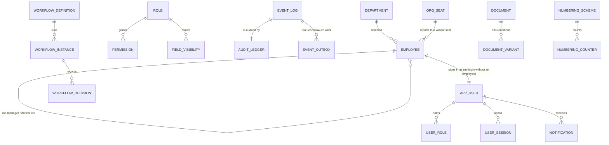

# MyCity App ERP · Database Design

The one map of the database: what exists, which milestone owns it, how a milestone's tables attach
to the core, and what is still to be built, with what is deliberately not built and why. An
engineer starting a milestone reads this first, then `docs/MIGRATIONS.md` for how to write the
files.

| Document | Settles |
|---|---|
| `docs/MyCity-ERP-Documents/MILESTONES.md` | Scope and decisions A1 to A26. Binding |
| `docs/guides/<module>.md` §4 | The tables a feature needs, field by field |
| **This file** | What is built, where, who owns it, and what each milestone still owes |
| `docs/MIGRATIONS.md` | How a migration or reference seed is written and checked |
| `migrations/`, `seeds/reference/` | The schema itself. Where this file and the SQL disagree, the SQL is the fact and this file is fixed |

Status as of 19/10/2026 (`main` with attendance's clock, `1300` and `1390`, remote staff's approved homes, `1310` and `1391`, work location requests, `1320` and `1392`, field assignments, `1330` and `1393`, hybrid staff's weekly schedule, `1340`, a client visit's site, `1350`, Home's foundation, `1150` and `1199`, Home's alerts, `1151`, the mailbox's image trust, `1125`, email signatures, `1127` and `1129`, web push, `0460`, and the effective manager through a vacant seat, `1160`): 76 files, 164 tables and 6 views. Gate 6
(`check/schema-drift.js`, `check/contract-columns.js`) checks the code and the contract against
the same reading of the migrations on every PR.

---

## 1 · Shape of the database

- **Two databases, not two schemas:** `mycity_stg` and `mycity_prod`, each with its own role and
  no cross-grants (SYSTEM_ARCHITECTURE §5). Every table is in `public`.
- **One migration ledger,** `schema_migration` (name, sha256, applied_at), written only by
  `scripts/db/migrate.js`. Files apply by number, `migrations/` and `seeds/reference/` interleaved.
- **One environment marker,** `system_marker(environment)`, one row, written when the database is
  created (provisioning on servers), never by a migration. Seed tooling refuses a database whose
  marker is missing or says `production`.
- **Extensions:** `pgcrypto`, `citext`, `pg_trgm`, `unaccent` (trusted, created by `0001`) and
  `vector` (untrusted, created by `ops/provision/provision.sh` as the superuser first).
- **Shared functions** (`0001`): `set_updated_at()` for every mutable table's trigger,
  `prevent_ledger_mutation()` for append-only tables, `search_fold()` for accent-folded search.

## 2 · The core every milestone builds on (M0)

Every module's tables hang off a small core. A new table attaches to it in the ways below and never
builds its own copy of any of them (CLAUDE.md: no second copy of a shared concern).

| Concern | Tables | Written by (the only writer) | How a module attaches |
|---|---|---|---|
| People and structure | `employee`, `department`, `worksite`, `org_seat`, `reporting_line` | organisation service, staff importer | `employee_id uuid REFERENCES employee`. Team scope follows the solid line: `employee.line_manager_id`, or, for someone who reports to a vacant seat, the first person above it (`employee_effective_manager`, `1160`). The dotted line never grants scope |
| Sign-in | `app_user`, `user_session`, `password_reset`, `known_device`, `mfa_recovery_code`, `passkey`, `spent_challenge` | identity service; the security service for two-step, the PIN and passkeys (the `mfa_*` and `pin_*` columns of `app_user`, `mfa_recovery_code`, `passkey`, `spent_challenge`) | `user_id` for who acted; never an email or a name. A key, a code, a PIN or a credential is never copied out |
| Access | `role`, `permission`, `field_visibility`, `capability`, `user_role`, `user_capability` | access service | A module's permission key in `access.catalog.js`; restricted columns named in `field-mask.js` |
| History | `event_log`, `audit_ledger` (append-only), `event_outbox`, `entity_state_history` | `emit()` in the same transaction as the write | Every write calls `emit()`; follow-on work is an outbox handler, never a second write path |
| Approvals | `workflow_definition`, `workflow_instance`, `workflow_decision` | `shared/workflow` | `workflow_instance_id` on the record waiting for approval; definitions seeded only if they pass `validateDefinition()` |
| Files | `document`, `document_variant`, `template`, `template_version`, `document_request` | `shared/documents/vault`; the documents service for `document.verified_at` and `document_request` | `document_id uuid REFERENCES document`; never a path or a URL. A document People asked for and have not been given is a `document_request`, not a `document` (`docs/guides/foundation.md` §6.9) |
| Numbers | `numbering_scheme`, `numbering_counter` | `numbering.allocate()` | `number citext NOT NULL UNIQUE` (or the contract's name for it, `staff_number`) and a scheme in `schemes.js` |
| Notifications | `notification`, `notification_preference`, `push_subscription`, `push_delivery`, `alert` | `shared/notifications` fan-out (`notification`); the notifications service (preferences and devices) and its push sender (`push_delivery`) | An outbox handler that calls the fan-out; never an insert into `notification` |
| Settings | `setting`, `working_week`, `public_holiday`, `reference_value` | settings service | Read settings; a code list the code switches on is a `reference_value` domain |
| Imports | `import_batch`, `import_row`, `import_mapping_profile` | `shared/import` engine | An importer in the module (`<module>.import.js`) |
| Errors, tokens, secrets, AI | `error_event`, `idempotency_key`, `public_token`, `integration_secret`, `ai_setting`, `ai_run`, `ai_run_step`, `ai_catalogue` | shared observability, http, security and AI layers | Not attached to directly; the AI reads through manifests only (A23) |

Every core table above was checked against the shared code that writes it by running
`tests/integration` on the real migrations (#26, #27): the code and the schema agree, and CI keeps
them agreeing.

## 3 · By milestone

Blocks are README §6.3. **Built** lists the tables in `main`. **Owes** is what the milestone's scope
and guides need that is not built yet, from the coverage audit of 16/10/2026; each owner closes it
with new files in their own block, following `docs/MIGRATIONS.md`. A merged file is never edited.

### M0 Foundation · 0001 to 0999 · GE (architecture), LA (migrations and data)

**Built:** `0001` extensions and functions · `0002` `schema_migration`, `system_marker` · `0010`
identity · `0020` access · `0030` events, audit, outbox, errors, idempotency · `0040` organisation ·
`0050` settings · `0055` numbering · `0060` notifications · `0070` workflow · `0080` documents and
templates · `0085` imports · `0090` tokens and secrets · `0095` AI ledger · `0099` reference seed ·
`0100` shared-layer columns · `0110` employee profile, dotted line, `org_seat` · `0120` foreign key
indexes · `0130` `error_event.extra` · `0199` code lists, Saturday, staff numbers · `0200` sessions
(last seen, how opened, device, end reason), credential links for invitations, a role's Home view
and rank · `0210` `employee.home_address` and `contract_ends_on` · `0300` the register: archiving
(`archived_at`, `archive_reason`, `archived` in the status check), `start_date` no longer NOT NULL (a
joining date MyCity does not hold is absent rather than wrong), and the indexes every allow-listed
sort, filter and search of the register reads, with a trigram index on name and post ·
`0349` the `archived` code list · `0220` sign-in methods: two-step
(`mfa_frequency`, the pending key, the last step used, a browser's trust, `mfa_recovery_code`), the
PIN and its wrong-try counts, `passkey`, `spent_challenge`, `user_session.reauthenticated_at` and
`pin_totp` sessions (`docs/guides/identity.md` §4) · `0290` the seven roles and their permission
matrix (`docs/guides/identity.md` §8) · `0350` `document_request` (what People asked an employee for)
and `document.verified_at` and `verified_by` (People accepting a file, which the virus check does
not say; `docs/guides/foundation.md` §6.9) · `0400` `role_capability` (a capability given with a
role), `role.two_step_required`, the Audit Log's indexes on `audit_ledger` and live sessions, and the
`two_step_setup` purpose on `spent_challenge` (`docs/guides/foundation.md` §4, §6.4) · `0449` the
field visibility of every role and the two capabilities given to Implementation, Operations & People
and Management (`docs/guides/foundation.md` §6.3) · `0450` `reassign` as a `workflow_decision` (a stage
given to someone else; `docs/guides/foundation.md` §11) · `0460` web push (brought forward from M6 by
TB, 19/10/2026; `docs/guides/notifications.md` §4): `push_subscription` as a device (its
`known_device`, label and platform, the hash of its device token, the key id it was made under, its
health and why it stopped) and `push_delivery`, one row per notice and device, so a retried push is
never sent twice · `0499` the leave flow, `leave.approval` (the line manager, then Operations &
People over 5 days; §6.5).

**Owes:**
- The `system_marker` row: provisioning does not write it yet (`ops/provision/provision.sh`).
- `employee_team_closure` (`0040`) is read by no code since 19/10/2026: team scope walks
  `employee_effective_manager` (`1160`) and the reporting-loop check walks people and seats in
  `organisation.repo.wouldLoop`. Drop it in a later file once GE agrees (MIGRATIONS §8).
- ~~The staff importer must advance the `employee` counter past imported staff numbers.~~ Built
  17/10/2026: `numbering.advanceTo()`, called by the organisation service whenever a staff number
  arrives with its record, and by the roster loader at the end of a load.
- **Read by Home** (home.md §4.1, §6 Alerts): Home reads these through their modules' own
  functions, except its alert metrics (`src/modules/alerts/alerts.metrics.js`), which read
  `workflow_instance` (`state = 'pending'`, `stage_entered_at`, `current_stage`, `entity_type`,
  `entity_id`, `subject_employee_id`) with `workflow_definition` (`name`, `stages`) for the
  `approval_ageing` metric; `document` (`is_current`, `scan_status`, `expires_on`, `title`,
  `subject_employee_id`) for `document_expiry`; and `employee` (`status`, `first_name`,
  `last_name`, `confirmation_due_on`, `confirmed_on`, `contract_ends_on`) for `confirmation_due` and
  `contract_ending`, and for the names on every alert about a person. A change to those columns
  or their meaning updates the metric in the same PR.

### M1 Core Operations · 1000 to 1999 · TB (Home), LA (attendance), GE (community, mailbox), AJ (ESS)

**Built:** `1000` Home alerts and rules, reports and schedules, attendance (policy, events, day,
exceptions), leave (types, balances, requests), community (channels, members, messages, reactions,
recognition), announcements, mailbox (accounts, folders, threads, messages, attachments) · `1099`
seed · `1100` `home_alert` columns the alerts code writes · `1110` community: post policy, pinned
and system channels, delivered pointer, the wider message kinds, transcripts, poll votes, presence,
`announcement_read` and the announcement's message, audience size and reminder · `1120` mailbox:
connection status and errors, folder kinds and sync cursor, thread keys, the reader's message
fields, `mail_draft` and `mail_send_queue` · `1125` `mail_image_trust` (the senders whose web images a
mailbox owner always shows) · `1127` email signatures: `mail_signature` (a person's office line and
their Show Mobile and WhatsApp switches; the mobile stays `employee.phone`) and
`mail_signature_config` (the company's app and social links, the confidentiality note and what
shows, one row at most); the baked signature rides in `mail_send_queue.payload` and its pictures
are vault documents (`mail_signature_image`) · `1129` reference data: the `mailbox.signature`
capability for System Administrator and Implementation · `1130` an announcement can be `cancelled` · `1140` each
member's own pin (`community_member.pinned_at`) · `1150` Home: a rule's name and who made and
changed it; `home_alert.subject_employee_id` (the employee an alert is about, which scopes the
Alerts list); a report's `archived_at`; a schedule's start day, run time, formats (PDF, XLSX) and
recipients as users, one schedule per report; `home_report_run` (one numbered file per recipient and
format, a scheduled slot generated once); `role_kpi` (a role's default and locked KPI cards, at most
four) and `home_kpi_pick` (the cards a person chose); the indexes the Alerts list, the report
scheduler and run history read; and, for Activity Today, `event_log (occurred_at)` · `1151`
`home_alert.due_on`, the date a deadline alert is about, so one a person cleared is raised again
when the date changes · `1160` `employee_effective_manager`, a view: the person each employee
answers to, their line manager or, under a vacant seat, the first person above the seat, read by
approvals, team scope and the notifications that follow it (`docs/guides/organogram.md` §4, §6) ·
`1199` Home
reference data: the
capabilities `home.team`, `home.reports` and `alerts.manage` with their role grants (and
`alerts.clear` for Heads of Department and Managers), the `report_run` numbering scheme
(`RPT-0001`), and `1099`'s three alert thresholds removed (A26, §5) · `1200` leave requests as the
leave module writes them (the four statuses checked, `recorded_by`, `cancelled_at`, the list
indexes) · `1290` the leave status code list (Cancelled added, Draft switched off) and the four
leave types · `1300` attendance as the clock writes it: the policy's `geofence_mode`,
`device_mode` and `max_accuracy_m`; `attendance_device` (a person's clock-in devices on
`known_device`, observed, registered or removed); the event's `work_date`, `device_at`, device,
policy, `idempotency_key` and correction fields, one active clock-in and one active clock-out a day
(a partial unique index), the ledger made append-only; the day's status nullable; the exception's
event, outcome, the person's note and the five types, deduplicated by partial unique indexes ·
`1310` remote staff's approved homes: `attendance_home` (a home location as the person sent it,
waiting, approved, rejected or superseded; at most one waiting and one approved per person by
partial unique indexes), the policy's `home_radius_m` (100 m) and the `outside_home` exception
type · `1390` the two new exception types' names in the code list · `1391` Outside Home in it ·
`1320` work location requests: `attendance_location_request` (a temporary home, a remote day or a
client visit for some days, numbered, decided in its approval and copied back; the point only for a
temporary home, personal data) · `1392` the `location_request` numbering scheme (`WLR-0001`) and
version 1 of the `attendance.location_request` approval (the line manager, then Operations & People) ·
`1330` field assignments: `attendance_field_assignment` (people sent to one or two sites for up to 31
days by their line manager or People, numbered, in force at once), `attendance_field_site` (its one
or two sites, a centre and a radius of 100 to 500 m) and `attendance_field_member` (the people on
it, a person taken off keeping their row) · `1393` the `field_assignment` numbering scheme
(`FA-0001`) · `1340` hybrid staff's weekly schedule: `attendance_schedule` (the office days, ISO
weekdays, from a first day, one row per person per first day; the latest started by a date is in
force; the other working days are home days) · `1350` a client visit's site on
`attendance_location_request` (`site_latitude`, `site_longitude`, `site_radius_m` 100 to 500 m, all
three or none, client visits only).

Home claims `1150` to `1159` and `1199` in this block (TB, 17/10/2026); attendance, devices and the
other M1 modules take numbers outside them. The organogram takes `1160` to `1169` (TB, 19/10/2026).

**Owes:**
- Attendance (attendance.md §4, §13): policy versions and acknowledgements (#89), a unique key
  for the auto-query
  upsert, the lateness deduction amount; dropping the superseded booleans `require_geofence` and
  `require_known_device` (MIGRATIONS §8).
- Attendance, for Home (LA): the shared roster (`src/modules/attendance/attendance.roster.js`)
  reads `attendance_day` as `1300`'s code writes it (the punch, People's decisions, the day-close)
  and a day with no record by the register's rules, through `1300`'s and `1200`'s indexes; it needs
  no index of its own, so `1150` no longer adds `attendance_event (occurred_at)`. Its statuses are
  the register's (`present`, `late`, `absent`, `leave`, checked by `1300`) in Home's words, with
  `present` split into on site, remote (by `employee.work_pattern`, an approved remote day or a
  hybrid home day by `attendance_schedule`, `1340`) and
  field (a field assignment covering the day, `1330`). When the register's statuses change, the
  roster's mapping changes in the same PR (`tests/integration/attendance-roster.test.js` holds the
  two together).
- **Read by Home** (home.md §4.1, §6 Alerts): besides the roster, Home's alert metrics
  (`src/modules/alerts/alerts.metrics.js`) are the one other reader of `attendance_day`
  (`employee_id`, `attendance_date`, `status = 'late'`, `first_clock_in_at`, `last_clock_out_at`,
  `closed_at`: the `late_arrivals` metric, and `missing_clock_out` for a day still open) and
  `attendance_exception` (`attendance_day_id`, `exception_type = 'missing_clock_out'`,
  `attendance_event_id IS NULL`: the `missing_clock_out` metric). A change to those updates the two
  entries in the same PR.
- ~~Home (home.md §4): `home_report_run`, `role_kpi` (per-role tile defaults and locks), alert
  scope.~~ Built 17/10/2026 in `1150`: `home_report_run`, `role_kpi` and the personal
  `home_kpi_pick`. "Alert scope" became `home_alert.subject_employee_id`: the Alerts list is scoped by
  the employee an alert is about, and a rule has no scope of its own.

### M2 Productivity & Performance · 2000 to 2999 · AJ

**Built:** `2000` projects, tasks, assignees, comments, calendar events, goals, KPIs, targets,
performance cycles, reviews and review items · `2099` seed.

**Owes:**
- Goals cascade as A16 sets it (organisational, annual, monthly, departmental, individual KPI),
  with code, strategic theme, success measure, baseline and the CEO's final approval.
- Tasks: the record a task points at (`entity_type`, `entity_id`), the KPI it counts towards,
  manager-set weekly and daily cadence (A24), the cancelled status.
- Calendar: attendees, visibility, the interview it belongs to.
- Reviews: the second-level and HR stages and their workflow; dictation transcript, cleaned text
  and `ai_run_id` (A18).
- Numbering: `project` has `number NOT NULL` and no scheme in `schemes.js`.
- **Read by Home** (home.md §4.1): `task` (`task_id`, `title`, `status`, `priority`, `due_at`,
  `completed_at`, `archived_at`, `primary_assignee_id`) through `src/modules/dashboard/sources/tasks.source.js`;
  `calendar_event` (`calendar_event_id`, `title`, `event_type`, `owner_employee_id`, `starts_at`,
  `ends_at`, `all_day`) through `calendar.source.js`; `organisational_goal` (`organisational_goal_id`,
  `level`, `title`, `status`, `starts_on`, `ends_on`) and `employee_target` (`employee_target_id`,
  `employee_id`, `title`, `due_on`) through `goals.source.js`; `performance_review`
  (`performance_review_id`, `performance_cycle_id`, `employee_id`, `reviewer_employee_id`,
  `review_type`, `submitted_at`) with `performance_cycle` (`performance_cycle_id`, `name`,
  `closes_at`) through `reviews.source.js`. The PR that changes any of these updates the adapter in
  the same PR, and the one that defines a goal's progress makes Goals On Track and My Targets live.
  Indexes asked by Home: `task (due_at) WHERE archived_at IS NULL AND completed_at IS NULL`,
  `calendar_event (owner_employee_id, starts_at)`, `organisational_goal (level, starts_on, ends_on)`,
  `employee_target (employee_id, due_on)`.
  **Staging holds Home's demonstration rows** in `task`, `calendar_event`, `organisational_goal`,
  `employee_target`, `performance_cycle` and `performance_review` (`seeds/staging/60_home.js`,
  decision O11). Their ids are written out in `HOME_STAGING_ROWS`
  (`seeds/staging/lib/home-staging-rows.js`), and the PR that adds this milestone's own staging seed
  takes them away once, in the three steps that file starts with: that seed calls
  `removeHomeStagingRows(client, [these tables])` in its transaction before it writes, which deletes
  the alerts Home raised about those rows and then the rows, children first; the PR takes the rows
  out of `seeds/staging/lib/forward-rows.js` and leaves their ids in the manifest, so the call finds
  them whichever seed runs first; and it takes the figures they gave out of Home's seed tests
  (`home-staging-seed.test.js` in `tests/unit/` and `tests/integration/`).

### M3 Queries & Consequence Management · 3000 to 3999 · GE

**Built:** `3000` query rules, queries, responses, sanctions, fines, letters · `3099` seed.

**Owes:**
- Query rules: the action, and the dedup key so three punches raise exactly one query.
- Letters for a query, not only for a sanction.
- Fines as pending deductions for the M6 payroll run (MILESTONES §8).
- The consequence workflow: `3099`'s `employee_consequence` fails `validateDefinition()` and must
  be replaced by a valid definition in a new seed.

### M4 Recruitment · 4000 to 4999 · TB

**Built:** `4000` vacancies and questions, candidates, applications and stage history, scorecard
criteria (A10), assessments, interviews, rounds, panelists and blind feedback · `4099` seed.

**Owes:**
- The final score beside the provisional one, and the AI-provisional flag.
- **Read by Home** (home.md §4.1): `vacancy` (`vacancy_id`, `number`, `title`, `status`,
  `department_id`, `hiring_manager_id`, `positions`, `closes_at`), and for the Recruitment SLA alert
  rules `application` (`application_id`, `vacancy_id`, `candidate_id`, `stage`, `status`,
  `current_stage_entered_at`, `withdrawn_at`) with `candidate` (`candidate_id`, `first_name`,
  `last_name`), through `src/modules/dashboard/sources/vacancies.source.js`: update it in the same PR.
  Indexes asked by Home: `vacancy (status)`, `application (status, current_stage_entered_at)`.
  **Staging holds Home's demonstration rows** in `vacancy`, one for each open seat on the organogram
  (`seeds/staging/60_home.js`, decision O11). Their ids are written out in `HOME_STAGING_ROWS`
  (`seeds/staging/lib/home-staging-rows.js`), and the PR that adds this milestone's own staging seed
  takes them away once, in the three steps that file starts with: that seed calls
  `removeHomeStagingRows(client, ["vacancy"])` in its transaction before it writes, which deletes
  the alerts Home raised about those rows and then the rows, children first; the PR takes the rows
  out of `seeds/staging/lib/forward-rows.js` and leaves their ids in the manifest, so the call finds
  them whichever seed runs first; and it takes the figures they gave out of Home's seed tests
  (`home-staging-seed.test.js` in `tests/unit/` and `tests/integration/`).

### M5 Offers, Documentation & Onboarding · 5000 to 5999 · LA

**Built:** `5000` offers, signature requests and signatures, document requirements, onboarding
cases and checklist items, employment contracts, talent pool · `5099` seed.

**Owes:**
- **The two hashes on every signature row** (A12): `content_hash` and `artifact_hash`.
- Offer approval: `workflow_instance_id` and its workflow definition.
- The data-privacy acknowledgement, documentation verification status, onboarding plans and SOPs.

### M6 Payroll & Notifications · 6000 to 6999 · LA

**Built:** nothing in the block. Notifications are M0 (`0060`), web push and each person's
preferences too (`0460`, brought forward by TB on 19/10/2026).

**Owes, all of payroll** (MILESTONES §11, in scope): payroll runs, payslips, salary structures
and pay components, deductions (pending, accepted, in a run, including M3 fines and lateness),
statutory items (PAYE, pension, NHF, ITF, NSITF) effective-dated, the payroll approval workflow,
and reminder settings. The `payroll_run` and `payslip` numbering schemes are already seeded.
The earlier note that payroll was "deliberately not modelled" was not a decision and is withdrawn.

**Read by Home** (home.md §4.1): nothing yet. Payroll In Progress is a hidden card with no query and
`src/modules/dashboard/sources/payroll.source.js` declares no table. The PR that creates
`payroll_run` adds the query there (runs not finished, in the reader's scope), declares its columns
and makes the card live in the same PR.

### M7 Partnerships, CRM & Trackers · 7000 to 7999 · GE

**Built:** `7000` partners, contacts, opportunities and stage history, interactions, proposals,
agreements and obligations · `7099` seed.

**Owes:**
- Leads (new, contacted, qualified, converted, lost): no table.
- The pipeline as MyCity's tracker has it (MILESTONES §12): region, objective, potential impact,
  next action, date identified, comments; MyCity's twelve stages and partner types in place of the
  seeded ones (A26: business choices are not seeded).
- Mail threads bound to a record; proposal answers and `ai_run_id`; MOU and contract type, renewal
  date, viewed and expiring states, the agreement workflow.
- Numbering: `partner`, `partnership_opportunity`, `partnership_agreement` have no scheme in
  `schemes.js`.
- **Read by Home** (home.md §4.1): `partner` (`partner_id`, `name`, `partner_type`, `status`,
  `owner_id`, `created_at`), `partner_interaction` (`partner_id`, `occurred_at`),
  `partnership_opportunity` (`partnership_opportunity_id`, `partner_id`, `title`, `stage`, `status`,
  `owner_id`, `estimated_value`, `currency`, `expected_close_on`), `partnership_proposal`
  (`partnership_proposal_id`, `partnership_opportunity_id`, `number`, `value`, `currency`, `sent_at`,
  `accepted_at`) and `partnership_agreement` (`partnership_agreement_id`, `partner_id`, `number`,
  `title`, `status`, `starts_on`, `value`, `currency`, `owner_id`) through
  `src/modules/dashboard/sources/partners.source.js`: update it in the same PR. Replacing the seeded
  stages changes what the pipeline chart counts. Indexes asked by Home: `partner_interaction
  (partner_id, occurred_at DESC)`, `partner (owner_id)`, `partnership_opportunity (owner_id, status)`,
  `partnership_agreement (status, starts_on)`.
  **Staging holds Home's demonstration rows** in `partner`, `partner_interaction`,
  `partnership_opportunity`, `partnership_proposal` and `partnership_agreement`
  (`seeds/staging/60_home.js`, decision O11). Their ids are written out in `HOME_STAGING_ROWS`
  (`seeds/staging/lib/home-staging-rows.js`), and the PR that adds this milestone's own staging seed
  takes them away once, in the three steps that file starts with: that seed calls
  `removeHomeStagingRows(client, [these tables])` in its transaction before it writes, which deletes
  the alerts Home raised about those rows and then the rows, children first; the PR takes the rows
  out of `seeds/staging/lib/forward-rows.js` and leaves their ids in the manifest, so the call finds
  them whichever seed runs first; and it takes the figures they gave out of Home's seed tests
  (`home-staging-seed.test.js` in `tests/unit/` and `tests/integration/`).

### M8 Expenses & Budget Control · 8000 to 8999 · AJ

**Built:** `8000` budgets and lines, expense categories, requests and transactions, requisitions
and lines, disbursements · `8099` seed.

**Owes:**
- A requisition owns many requests (MILESTONES §13); `requisition.expense_request_id UNIQUE`
  makes it one, so this is a fix-forward change of shape.
- The approval threshold on the category; per-line flag, tick and remove; the vendor invoice
  `document_id`; payee details; the project link; `workflow_instance_id`.
- The trigger that refuses a disbursement without a payment reference.
- Statuses as the M8 chain has them; one numbering type for expenses (`expense` and
  `expense_request` are both seeded); `budget` has no scheme in `schemes.js`.
- **Read by Home** (home.md §4.1): `expense_request` (`expense_request_id`, `number`, `employee_id`,
  `expense_category_id`, `purpose`, `amount`, `currency`, `status`, `needed_on`, `submitted_at`) and
  `expense_category` (`expense_category_id`, `name`) through
  `src/modules/dashboard/sources/expenses.source.js`, and `budget` (`budget_id`, `number`, `name`,
  `department_id`, `owner_id`, `currency`, `starts_on`, `ends_on`, `approved_at`) with `budget_line`
  (`budget_id`, `amount`, `spent_amount`) through `budgets.source.js`: update them in the same PR.
  Indexes asked by Home: `expense_request (status)` and `(employee_id)`, `budget (owner_id)`.
  **Staging holds Home's demonstration rows** in `expense_request`, `budget` and `budget_line`
  (`seeds/staging/60_home.js`, decision O11). Their ids are written out in `HOME_STAGING_ROWS`
  (`seeds/staging/lib/home-staging-rows.js`), and the PR that adds this milestone's own staging seed
  takes them away once, in the three steps that file starts with: that seed calls
  `removeHomeStagingRows(client, [these tables])` in its transaction before it writes, which deletes
  the alerts Home raised about those rows and then the rows, children first; the PR takes the rows
  out of `seeds/staging/lib/forward-rows.js` and leaves their ids in the manifest, so the call finds
  them whichever seed runs first; and it takes the figures they gave out of Home's seed tests
  (`home-staging-seed.test.js` in `tests/unit/` and `tests/integration/`).

### M9 Settings & Governance · 9000 to 9999 · GE

**Built:** `9000` security events, access reviews and items, integrations, webhooks · `9090`
reporting views · `9095` `updated_at` triggers (a one-time sweep of the tables that existed then;
later tables create their own, `docs/MIGRATIONS.md` §6) · `9099` seed.

**Owes:** nothing from this list since 17/10/2026: two-step required per role and editing roles and
their grants on screen came forward to M0 with foundation track C (`0400`, `0449`;
`docs/guides/foundation.md` §6.3, §6.4).

### M10 Staff Knowledge Hub & AI Assistance · 10000 to 10999 · TB

**Built:** `10000` knowledge categories, articles, versions, embeddings, AI conversations,
messages, citations · `10099` seed.

**Owes:**
- `updated_at` triggers for these seven tables (they came after `9095`).
- Article audiences by role and department; MyCity's categories (SOPs, FAQs, Training).
- Citations of a database record, not only an article or a document (MILESTONES §15).
- The embedding dimension, fixed to the model `services/ai` uses, and its vector index.

### M11 Handover · 11000 to 11999 · TB

No tables needed: backups and drills are scripts (`scripts/db/backup.sh`, `restore-drill.js`).

## 4 · Not covered, and why

| What | Why it is not built | Decided by |
|---|---|---|
| Tables for M11 | Handover is scripts and documents, not records | MILESTONES §16 |
| Demonstration and business data in production | Reference seeds hold only what the code cannot run without; categories, stages, policies and thresholds are entered by MyCity | A5, A26 |
| (Exception) The four default leave types in production | Seeded in `1290` (Annual 20, Compassionate 5, Sick 12, Unpaid) with DO NOTHING; People change, retire or add types on People · Leave | The team lead, 17/10/2026 |

Anything else in MILESTONES that has no table yet is **owed**, not excluded, and is listed under
its milestone in §3.

Passkeys (WebAuthn) were listed here until 16/10/2026, when TB decided to build them with two-step
sign-in and the PIN in the second sign-in PR (M0 block), reversing REUSE_MAP's "drop WebAuthn for
now"; REUSE_MAP §1.1 and MILESTONES §5 record it. They are built: `passkey` in `0220`, with ESS My
Security's two-step and PIN, which M1 owed until then.

## 5 · Open decisions

1. **The M6 payroll design** (pay components, statutory rates and their effective dating) waits on
   the payroll contract and the tax-reform rules. The block is reserved and the scope stands.
2. **The role-to-module permission matrix.** Decided with TB on 16/10/2026: the seven roles MyCity
   runs on (from the staff list) and their grants, seeded by `0290_seed_roles_and_grants.sql`.
   Changes after go-live are made in Settings · Roles & Permissions (built in M0, 17/10/2026), not in
   a seed.
3. **The business choices PR 25 seeded** (expense categories, partner types and stages, the
   Standard attendance policy, alert thresholds, knowledge categories) move out of the seeds under
   A26, each when its milestone builds the screen that manages it. The alert thresholds moved out on
   17/10/2026: `1199` removes each of `1099`'s three rules while it is as seeded and no alert points
   at it, and MyCity enters its own on Home, Alerts.

## 6 · Changing this document

A PR that adds or changes a table updates this file in the same PR: the milestone's **Built** line
and, as items close, its **Owes** list. A new exclusion goes in §4 only with the document or
decision that makes it. `docs/MIGRATIONS.md` §12 carries the checklist.
